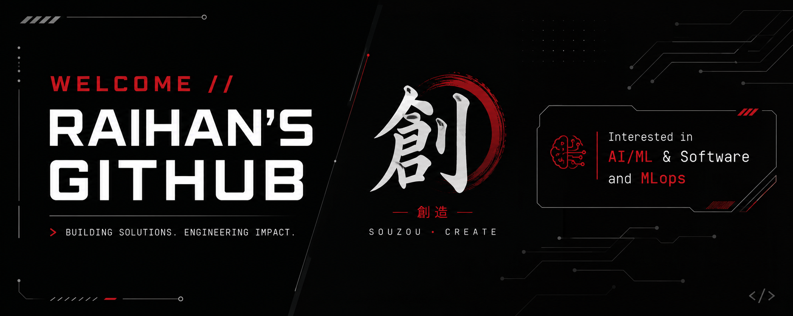

## *****●・○・●・○・● AI • Programming • MLops • Builder ●・○・●・○・●*****

  

Let’s connect: ⚡ •  [LinkedIn](https://www.linkedin.com/in/sk-raihan-ali-2a123b2bb/) • [Email](mailto:raihanali73377@gmail.com) • ⚡ Exploring new horizons

#  𝑨𝒃𝒐𝒖𝒕 𝑴𝒆 ᯓ★

➜ 𝘸𝘩𝘪𝘭𝘦(𝘢𝘭𝘪𝘷𝘦){  
  𝘤𝘰𝘥𝘦();  
  𝘭𝘦𝘢𝘳𝘯();  
  𝘣𝘶𝘪𝘭𝘥();  
  𝘴𝘤𝘢𝘭𝘦();  
}

➜ AI/ML enthusiast exploring intelligent systems & MLops  
➜ Building impactful software with clean design & futuristic thinking  
➜ Interested in Robotics, Automation & next-gen technology  
➜ Turning ideas into projects — one commit at a time

#   𝑻𝒆𝒄𝒉 𝑺𝒕𝒂𝒄𝒌 ᯓ★

#  𝑭𝒆𝒂𝒕𝒖𝒓𝒆𝒅 𝑷𝒓𝒐𝒋𝒆𝒄𝒕𝒔 ᯓ★

→ Showcasing projects that blend creativity, automation, and practical problem-solving.

🔹 AttendWise — Smart Attendance Management System

🔹 StudySphere AI — Intelligent Study Assistant

🔹 Resume Generator — Create professional resumes in PDF & Word formats

🔹 Sakura Theme Letter — Interactive themed web experience

🔹 DB Connect — Database connectivity and management utilities

🔹 Personal Portfolio & Web Development Experiments

#  𝑮𝒊𝒕𝑯𝒖𝒃 𝑰𝒏𝒔𝒊𝒈𝒉𝒕𝒔 ᯓ★

  

   

---

#  𝑴𝒚 𝑫𝒊𝒈𝒊𝒕𝒂𝒍 𝑺𝒑𝒂𝒄𝒆 ᯓ★

  

 

  

  

#  𝑪𝒖𝒓𝒓𝒆𝒏𝒕𝒍𝒚 𝑬𝒙𝒑𝒍𝒐𝒓𝒊𝒏𝒈 ᯓ★

- AI & Machine Learning  
- MLops & Intelligent Systems  
- Robotics & Embedded Systems  
- Full-Stack Development  
- Cloud & Automation  

⚡ 𝑳𝒆𝒂𝒓𝒏𝒊𝒏𝒈 • 𝑩𝒖𝒊𝒍𝒅𝒊𝒏𝒈 • 𝑬𝒙𝒑𝒆𝒓𝒊𝒎𝒆𝒏𝒕𝒊𝒏𝒈... ⚡

